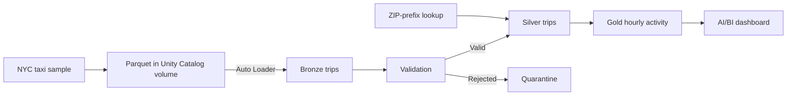

# NYC Taxi Lakehouse

A small end-to-end data engineering project for Databricks Free Edition. It stages real NYC taxi data in Parquet, processes new files with Auto Loader and PySpark, and serves an hourly Delta aggregate to Databricks SQL.

[Explore the interactive portfolio demo](https://itaycohen5.github.io/nyc-taxi-lakehouse/)

## Deploy

1. In your workspace, import [prepare_demo.py](src/prepare_demo.py) as a Python notebook. On Serverless, select a writable catalog in the `catalog` widget and run with `batch=first`. It creates the `nyc_taxi` schema, reference table and landing volume, then prints the two pipeline configuration values.
2. Create a triggered serverless ETL pipeline named **NYC Taxi Lakehouse**. Set its output catalog to the same catalog and schema to `nyc_taxi`. Replace the generated transformation with [taxi_pipeline.py](src/taxi_pipeline.py). Add `taxi.volume` and `taxi.reference` in pipeline settings, using the values printed in step 1. If the catalog name contains a hyphen, quote it with backticks in the table reference.
3. Create an on-demand Lakeflow Job named **NYC Taxi | Refresh** with a single pipeline task pointing to this pipeline. Run a standard update.
4. In an AI/BI dashboard, create a SQL dataset from [dashboard.sql](sql/dashboard.sql). Set the catalog and schema to the pipeline output. Add a bar or line chart with hour on X, trip count on Y, and pickup borough as series.

You can also deploy the pipeline, job, and dashboard from [databricks.yml](databricks.yml) after running step 1. With an authenticated Databricks CLI profile, run `databricks bundle validate --var catalog=YOUR_CATALOG --var warehouse_id=YOUR_WAREHOUSE_ID`, then run `databricks bundle deploy` with the same two variables. The dashboard is defined in [nyc_taxi.lvdash.json](sql/nyc_taxi.lvdash.json).

## Demo and checks

Run [verify.sql](sql/verify.sql) against the output schema after each update.

| Action | Expected result |
| --- | --- |
| Stage `first`, run the job | 10,000 Bronze rows and reconciliation passes |
| Stage `second`, run the job | 20,000 Bronze rows and a second source file |
| Run again with no new files | 20,000 Bronze rows and unchanged counts by source file |
| Stage `invalid`, run the job | 20,001 Bronze rows and one new `INVALID_TRIP_TIME` rejection; Silver and Gold counts stay stable |

Run regular updates throughout the demo. Keep landed files immutable so Auto Loader can track processed paths. File-level replay protection does not deduplicate an identical record delivered in a new file.

### Verified in Databricks Free Edition

| Update | Bronze rows | Silver rows | Quarantined | Gold trip count | Source files |
| --- | ---: | ---: | ---: | ---: | ---: |
| First batch | 10,000 | 9,966 | 34 | 9,966 | 1 |
| Second batch | 20,000 | 19,926 | 74 | 19,926 | 2 |
| No new files | 20,000 | 19,926 | 74 | 19,926 | 2 |
| Invalid fixture | 20,001 | 19,926 | 75 | 19,926 | 3 |

The injected fixture appeared exactly once with `INVALID_TRIP_TIME`. The published dashboard's SQL dataset returned 92 hourly borough groups. The dashboard layout was deployed and its dataset was verified through SQL.

## Data and scope

The demo uses [Databricks’ built-in NYC taxi sample](https://docs.databricks.com/aws/en/discover/databricks-datasets#nyctaxi) to avoid external network dependencies in Free Edition. It stages up to two 10,000-row monthly batches and a one-row synthetic fixture. The ZIP-prefix lookup is an illustrative approximation, with unmatched prefixes labeled `Unknown`. Gold summarizes fare amounts, rather than full passenger charges. The Gold grain is pickup date, hour, and borough.

## Portfolio site and attribution

The site under `docs/` reads a dated snapshot of the Gold aggregates and the four verified pipeline updates. To rebuild it, export the rows from [portfolio_export.sql](sql/portfolio_export.sql) as a JSON array and record the results of [verify.sql](sql/verify.sql) in JSON Lines using the fields in [snapshot.json](docs/snapshot.json). Then run `python scripts/build_snapshot.py hourly.json runs.jsonl --date YYYY-MM-DD` from the repository root.

This project was built for Itay Cohen with assistance from Codex. The staging workflow, quarantine rules, reconciliation checks, and public dashboard were developed for this repository. The implementation uses the documented [Lakeflow Python API](https://docs.databricks.com/aws/en/ldp/developer/python-ref) and [Auto Loader](https://docs.databricks.com/aws/en/ingestion/cloud-object-storage/auto-loader/).
